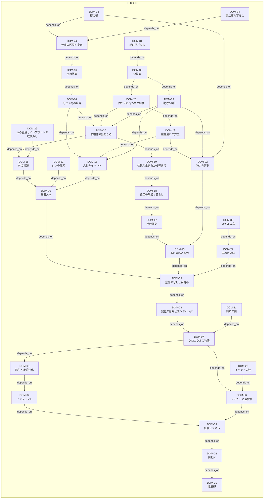

# ネオン・クロニクル（Neon Chronicle）

サイバーパンクの街で仕事をこなし、体が尽きたら記憶を持って新しい体で目覚める、放置と転生のゲームである。Godot 4.7.2とGDScriptで作っている。

まず無料のブラウザ版をitch.ioで出し、あとからPC版（itch.io・Steam）でMODを受け付ける。ブラウザ版ではMODを読まない。

## 読む順番

| 何を知りたいか | どこを読むか |
| --- | --- |
| ゲームの遊び方と、`game/`の中身 | [game/README.md](game/README.md) |
| 本体の構成と、MODとの境界 | [ARCH-01](docs/10-architecture/arch-01-game-overview.md) |
| 設計文書の置き方 | [docs/index.md](docs/index.md) |
| 開発の流れ | [META-05](docs/00-meta/dev-flow.md)と[META-07](docs/00-meta/issue-pr-flow.md) |

## 構成

| 場所 | 中身 |
| --- | --- |
| `game/` | Godotのプロジェクト |
| `docs/` | 設計文書（グラフ）。[graph-project-template](https://github.com/setopic/graph-project-template)から派生している |
| `tools/graph/` | 設計文書の検証ツール。テンプレートが配る |
| `media/screenshots/` | ストアのページに使う画面写真 |

## 未確定なもの

音楽と効果音は、まだ決まっていない。残りの作業はGitHubのissueとProjectで管理する。

## 設計文書の図

<!-- graph:diagram:start -->

<!-- この図は render --into が生成する。手で編集しない -->

<!-- graph:diagram:end -->
