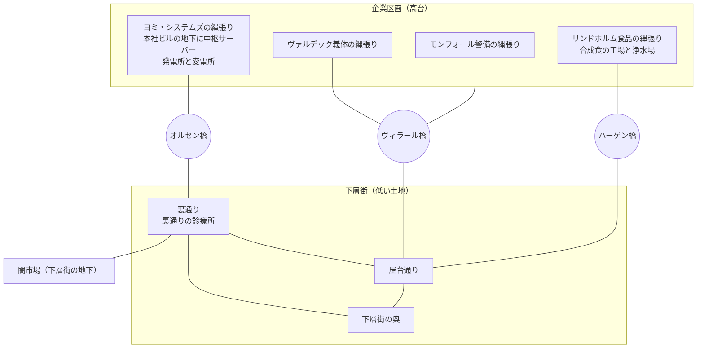

# 街の場所と勢力

## 定義

[ネオン・シティ](./dom-01-world.md)の中で、[仕事](./dom-03-jobs-and-skills.md)と[イベント](./dom-06-events.md)の舞台になる場所と、街を動かしている勢力である。勢力は、[企業](./dom-01-world.md)の各社と、企業に属さない人々の集まりからなる。どれも文だけで、ゲームの数値は持たない。

## 属性

場所は次の3つである。

| 場所 | どんなところか | 出る仕事とイベント |
| --- | --- | --- |
| 下層街 | 企業区画の高層ビルの下に広がる、日の当たらない街。[裏通りの診療所](./dom-09-consciousness-copy.md)も、運び屋の走る路地もここにある | 運び屋、「路地の通行料」「薬の配達」「合成食の荷運び」「盗電の線」「古い銘板」 |
| 闇市場 | 下層街の地下にある市場。盗んだデータ、体の部品、インプラントが売り買いされる。企業の買い手も、身元を隠して出入りする | ハッカー（盗んだデータを売る先）、「闇市場の買い手」 |
| 企業区画 | 企業の高層ビルが並ぶ区画。社ごとに縄張りが分かれ、それぞれの企業の私兵が守っている。下層街とは3本の橋でつながる | 傭兵、「待ち伏せ」「ジンの忠告」「変電所の奪い合い」 |

場所は、区画に分かれる。区画は次の8つである。

| 場所 | 区画 | どんなところか |
| --- | --- | --- |
| 企業区画 | ヨミ・システムズの縄張り | 本社ビルの地下に、[中枢サーバー](./dom-08-memory-fragments-and-endings.md)がある。街の電気を作る発電所がある。オルセン橋のたもとに、変電所がある |
| 企業区画 | ヴァルデック義体の縄張り | ヴィラール橋の片側にある。本社と、義体を作る工場がある |
| 企業区画 | モンフォール警備の縄張り | ヴィラール橋のもう片側にある。橋を見張る本社がここにある |
| 企業区画 | リンドホルム食品の縄張り | 合成食を作る工場と、浄水場がある。ハーゲン橋から、合成食が下層街へ運ばれる |
| 下層街 | 屋台通り | ヴィラール橋とハーゲン橋を下りたところに広がる、屋台の並ぶ通り |
| 下層街 | 裏通り | オルセン橋を下りたところにある、運び屋の走る路地。裏通りの診療所と、闇市場の入口がある |
| 下層街 | 下層街の奥 | どの橋からも遠い、小屋とコンテナが積み重なった地区 |
| 闇市場 | 闇市場 | 下層街の地下にある。入口は裏通りに1つだけある |

企業区画は高台にあり、下層街はその下の低い土地に広がる。高台の縁は崖で、崖の下を下層街の排水路が流れる。2つは、排水路をまたぐ次の3本の橋でつながる。橋はどの社の持ち物でもなく、モンフォール警備が見張っている。

橋は、企業が街を分け合うより前の時代に、その橋を架けた人の名前で呼ばれる。架けた人と、橋がどの社の持ち物でもない理由は、[DOM-17](./dom-17-city-history.md)が決めている。

| 橋 | 企業区画の側 | 下層街の側 | 出るイベント |
| --- | --- | --- | --- |
| オルセン橋 | ヨミ・システムズの縄張り | 裏通り | 「ジンの忠告」「変電所の奪い合い」 |
| ヴィラール橋 | ヴァルデック義体とモンフォール警備の縄張りの間 | 屋台通り | |
| ハーゲン橋 | リンドホルム食品の縄張り | 屋台通り | 「合成食の荷運び」「古い銘板」 |

区画とつながりを図にすると、次のようになる。線は、歩いて行き来できることを表す。

勢力は次の8つである。

| 勢力 | 企業か | 何をしているか | 作っている兵器 |
| --- | --- | --- | --- |
| [ヨミ・システムズ](./dom-01-world.md) | 企業 | 神経接続のチップと、街のネットの基幹を売っている | ネット越しに神経を焼く兵器 |
| ヴァルデック義体 | 企業 | 義体とインプラントを作って売っている。神経接続のチップでは、ヨミ・システムズと客を奪い合っている | 武器を仕込んだ戦闘用の義体 |
| モンフォール警備 | 企業 | どの社の持ち物でもない橋と下層街の治安を、各社が出し合った金で請け負う警備会社 | 自社の部隊のための銃と防具 |
| リンドホルム食品 | 企業 | 自社の縄張りにある工場の培養槽で合成食を作り、街のほとんどの店へ卸している | 培養槽で育てた毒 |
| 下層街の住人 | 属さない | 屋台や修理屋を営みながら、下層街で暮らしている。企業同士の争いのしわ寄せを受ける | |
| ザンダー一家 | 属さない | 裏通りと闇市場を仕切るギャング。闇市場で売り買いする者から場所代を、屋台通りの店からみかじめを取る。企業が下層街で表に出せない仕事を、闇市場を通して請け負う | |
| 屋台組合 | 属さない | 屋台通りと下層街の奥の屋台や修理屋がまとまった、住人の自治組織。雨水のタンクと浄水の分け方、盗電の線の引き方、住人どうしのもめごとの仲裁をまとめる | |
| 路地のチンピラ | 属さない | 下層街の路地にたむろして、通る者から金を取るチンピラの群れ。1つの組織ではなく、群れごとに、たむろする路地の角の名前などを勝手に名乗っていて、共通の自称は無い。住人からは、ダニやハイエナと蔑まれている。ザンダー一家には属さず、ザンダー一家の名前には逆らわない | |

企業は互いに製品と縄張りを奪い合っている。兵器は、各社が自社の製品の延長で独自に作っていて、ほかの社から買わない。ハッカーが盗むデータは、たいてい別の企業へ売られる。傭兵の仕事の多くは、ある企業に雇われて別の企業の縄張りを荒らすものである。

下層街では、ザンダー一家が裏通りと闇市場を仕切っている。闇市場の入口は裏通りに1つだけなので、入口を押さえれば場所代を取れる。モンフォール警備は、ザンダー一家から金を受け取って、裏通りでの一家の商売を見逃している。屋台通りの店は、みかじめを店ごとではなく屋台組合を通してまとめて払い、額は屋台組合がザンダー一家と話し合って決める。

企業の力は同じではない。強い順に、ヨミ・システムズ、リンドホルム食品、ヴァルデック義体、モンフォール警備である。ヨミ・システムズは街の電気とネットの基幹を、リンドホルム食品は街で食べる物と水を握っていて、ほかの社もこの2社なしでは立ち行かない。ヴァルデック義体は、チップの客をヨミ・システムズと奪い合うだけの力はあるが、街の暮らしを支えるものは握っていない。モンフォール警備は、各社の出資で橋と下層街を見張る立場で、縄張りは本社の周りだけである。縄張りの広さも、この順になっている。

衣食住は、企業区画と下層街で次のように違う。衣服と住居を作ったり握ったりする企業は無い。

| | 企業区画 | 下層街 | 出るイベント |
| --- | --- | --- | --- |
| 食 | 本物の肉や野菜も出回る | リンドホルム食品の合成食を、屋台が煮たり焼いたりして売る | 「合成食の荷運び」 |
| 衣 | 各社が社員と私兵に自社の制服を着せる | 企業区画から流れてきた古着や合成繊維を、住人が仕立て直して着る | |
| 住 | 社員は自社の縄張りの中の社宅に住む | 住人がビルの足元や橋の下に小屋やコンテナを積み上げて住む。家主はいない | |

インフラは、企業区画と下層街で次のように違う。インフラのための企業は無く、電気と水はいまの企業が握っている。

| | 企業区画 | 下層街 | 出るイベント |
| --- | --- | --- | --- |
| 電気 | ヨミ・システムズが発電所で作り、送電網で各社の縄張りへ送る | オルセン橋のたもとの変電所を通して送られる。住人の多くは、送電網から勝手に線を引いて使う | 「変電所の奪い合い」「盗電の線」 |
| 水 | リンドホルム食品が浄水場で浄め、水道で送る | 水道は無い。住人は雨水をためて濾すか、屋台で浄水を買う | |
| 交通 | 公共の交通は無い。各社が自社の車で社員を運ぶ | 公共の交通は無い。住人は歩くかバイクで移動し、荷物は運び屋が運ぶ | 「合成食の荷運び」 |

## 不変条件

- [ ] 企業は互いに競い合っている。1社がほかの社を従えてはいない
- [ ] ヨミ・システムズが主人公の意識をデータにしたことは、[記憶の断片](./dom-08-memory-fragments-and-endings.md)「契約書」が戻るまで、画面に出さない
- [ ] 各社の縄張りを守るのは、その社の私兵だけである
- [ ] 下層街の住人・ザンダー一家・屋台組合・路地のチンピラは、どの企業にも属さない
- [ ] 下層街のギャングは、ザンダー一家の1つだけである
- [ ] 下層街の住まいに家主はいない
- [ ] 街に公共の交通は無い
- [ ] 企業区画と下層街は、3本の橋でだけつながる
- [ ] 闇市場の入口は、裏通りの1つだけである

## ライフサイクル

場所と勢力は、周をまたいでも変わらない。

## 用語

| 用語 | 意味 | 旧称 |
| --- | --- | --- |
| 下層街 | 企業区画の下に広がる、企業に属さない人々の街。裏通りの診療所がある | |
| 闇市場 | 下層街の地下にある市場。盗んだデータ・体の部品・インプラントが売り買いされる | |
| 企業区画 | 企業の高層ビルが並び、私兵が守る区画。下層街とは橋でつながる | |
| ヴァルデック義体 | 義体とインプラントを売る企業。神経接続のチップで、ヨミ・システムズと競っている | |
| モンフォール警備 | 橋と下層街の治安を、各社の共同の出資で請け負う企業。どの社の縄張りも守らない | |
| 私兵 | 企業が自前で抱え、自分の縄張りを守らせる兵 | |
| 下層街の住人 | 下層街で暮らす、どの企業にも属さない人々 | |
| ザンダー一家 | 裏通りと闇市場を仕切るギャング。頭の家の名前で呼ばれる。どの企業にも属さない | |
| 屋台組合 | 屋台通りと下層街の奥の屋台や修理屋がまとまった、下層街の住人の自治組織 | |
| みかじめ | 屋台通りの店が、ザンダー一家に払う金。屋台組合がまとめて払う | |
| 場所代 | 闇市場で売り買いする者が、ザンダー一家に払う金 | |
| 路地のチンピラ | 下層街の路地にたむろして通る者から金を取る、どの組織にも属さないチンピラの群れ。1つの組織ではなく、共通の自称は無い。住人は、ダニやハイエナと蔑んで呼ぶ | |
| リンドホルム食品 | 合成食を作り、街のほとんどの店へ卸す企業 | |
| 合成食 | リンドホルム食品が培養槽で、藻と培養した肉から作る食べ物。下層街で食べる物のほとんどがこれである | |
| 社宅 | 企業が自社の縄張りの中に建て、社員を住まわせる住まい | |
| 送電網 | ヨミ・システムズが、発電所の電気を企業区画の各社の縄張りと下層街へ送る線の網 | |
| 盗電 | 下層街の住人が、送電網から勝手に線を引いて電気を使うこと | |
| 浄水場 | リンドホルム食品が自社の縄張りに持ち、培養槽と企業区画の水道に使う水を浄める施設 | |
| 縄張り | 企業区画のうち、1つの企業が持ち、その社の私兵が守る区画 | |
| 屋台通り | 下層街の区画の1つ。ヴィラール橋とハーゲン橋を下りたところにあり、屋台が並ぶ | |
| 裏通り | 下層街の区画の1つ。オルセン橋を下りたところにあり、裏通りの診療所と闇市場の入口がある | |
| 下層街の奥 | 下層街の区画の1つ。どの橋からも遠く、小屋とコンテナが積み重なっている | |
| 排水路 | 企業区画の崖の下を流れ、下層街の水を流す水路。3本の橋がまたいでいる | |
| オルセン橋 | ヨミ・システムズの縄張りと裏通りをつなぐ橋。たもとに変電所がある | 北の橋 |
| ヴィラール橋 | ヴァルデック義体とモンフォール警備の縄張りの間と、屋台通りをつなぐ橋 | 中の橋 |
| ハーゲン橋 | リンドホルム食品の縄張りと屋台通りをつなぐ橋。合成食がここを通って下層街へ運ばれる | 南の橋 |

---

<!-- graph:auto:start -->

## 関連ドキュメント（自動生成 / 手で編集しない）

`depends_on`: この文書が成立するために前提となるノード

- [DOM-01 世界観](./dom-01-world.md)
- [DOM-06 イベントと選択肢](./dom-06-events.md)
- [DOM-08 記憶の断片とエンディング](./dom-08-memory-fragments-and-endings.md)
- [DOM-09 意識の写しと目覚め](./dom-09-consciousness-copy.md)

このノードを参照しているノード

- (decides) [ADR-0018 街を複数の企業が分け合い、場所と住人をイベントと資料に出す](../50-adr/adr-0018-companies-places-and-residents.md)
- (decides) [ADR-0019 衣食住は文だけで書き、食べ物は合成食の企業が握る](../50-adr/adr-0019-food-clothing-housing.md)
- (decides) [ADR-0020 街を区画と3本の橋で分け、地図は設計文書の図に残す](../50-adr/adr-0020-city-districts-and-map.md)
- (decides) [ADR-0021 電気はヨミ・システムズ、水はリンドホルム食品が握り、街に公共の交通は置かない](../50-adr/adr-0021-city-infrastructure.md)
- (decides) [ADR-0023 橋に人名を付け、地図を地形の分かる描き方にする](../50-adr/adr-0023-bridge-names-and-terrain-map.md)
- (decides) [ADR-0024 下層街に、ギャングのザンダー一家と住人の屋台組合を置く](../50-adr/adr-0024-lower-city-gang-and-union.md)
- (decides) [ADR-0025 企業の時代より前の街を市とし、市の財政破綻で企業の時代が始まったことにする](../50-adr/adr-0025-city-history-before-corporations.md)
- (depends_on) [DOM-14 街と人物の資料](./dom-14-city-and-people-profiles.md)
- (depends_on) [DOM-16 街の地図](./dom-16-city-map.md)
- (depends_on) [DOM-17 街の歴史](./dom-17-city-history.md)

<!-- graph:auto:end -->
